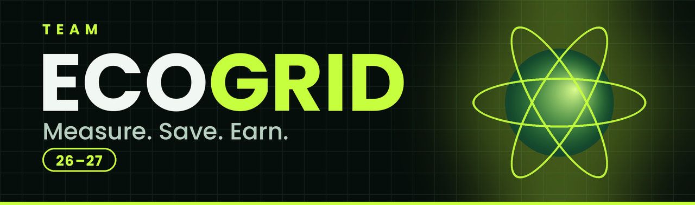
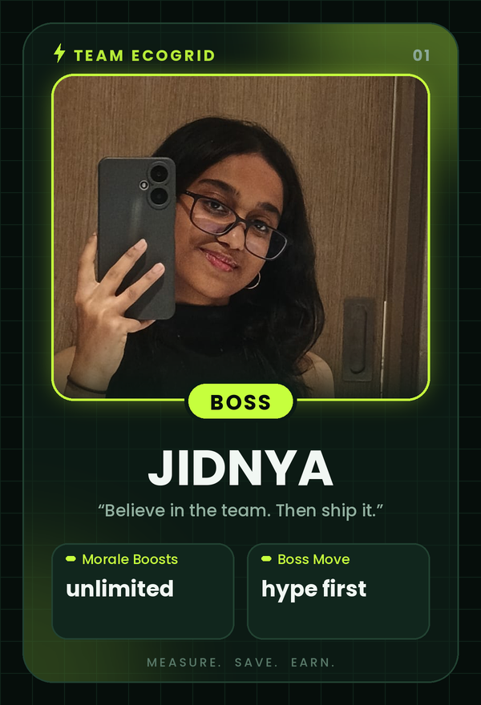
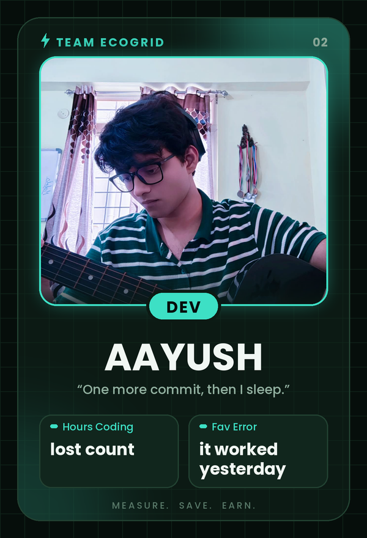
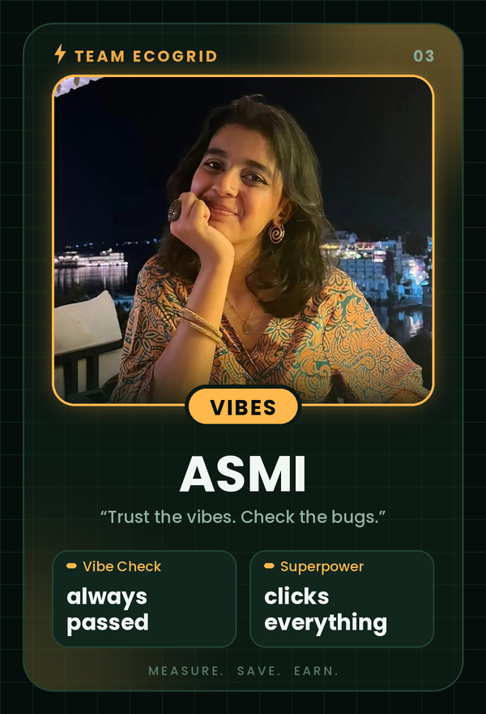

<div align="center">



<br>

**Campus electricity billing that's actually fun to look at.**
Log meter readings, generate printable bills, flex on the leaderboard.

<br>


</div>


## ⚡ What is EcoGrid?

Every month, every room on campus gets a meter reading. Stay **under the 100 kWh baseline** and you earn reward points. Go over it and the bill climbs at a flat ₹8 per kWh. EcoGrid keeps track of all of it, ranks everyone on a leaderboard, and spits out a clean, printable bill for each resident.

It's basically a group chat for your electricity usage, except the numbers don't lie.

### What it does

- **Residents and readings:** add a resident with a room number, then log a new meter reading every month.
- **Auto billing:** bill and reward points are recalculated the moment a reading is saved.
- **Leaderboard:** ranked by points, with search, tier filters and sortable columns.
- **Tiers:** Grid Guardian, Eco-Warrior, Green Saver, and Over Baseline (we don't talk about that one).
- **Energy graphs:** a campus-wide comparison chart plus a month-by-month history chart for each student.
- **Bill generator:** a print-ready A4 bill for every student. Hit *Print / Save as PDF* and you're done. There's also an all-bills page, one bill per page.
- **Live previews:** forms show the new bill and points *while you type*, and a slider lets you try any reading before you commit.


## 👥 Meet Team ECOGRID

**Team ECOGRID** is three people, one app, and a shared belief that an electricity bill should be less scary and a lot more stylish. One of us steers, one of us builds, and one of us makes sure it doesn't fall apart the second a real human touches it. Different strengths, same energy (the renewable kind).

| | Role | Powered by |
|---|---|---|
| **Jidnya** | The Boss | Pep talks and good vibes |
| **Aayush** | The Builder | Python and "one more commit" |
| **Asmi** | Chief Vibes Officer | Curiosity and clicking everything |

<br>

<table>
  <tr>
    <td width="42%" valign="top" align="center">
      
    </td>
    <td valign="top">
      <h3>Jidnya, the Boss 👑</h3>
      <p><i>Best boss ever. This is not up for debate.</i></p>
      <p><b>About Jidnya:</b> Jidnya is the heart and the compass of Team ECOGRID. She sets the direction, keeps everyone on track, and has a rare talent for noticing when the team's energy dips and fixing it before anyone says a word. Her feedback is honest, her pep talks are elite, and she celebrates every small win, whether it's a fixed bug, a finished page, or a button that finally works. People do their best work around her because they feel backed, not pressured.</p>
      <p>Deadline panic? She turns it into a plan. Bug at 2 a.m.? "We've got this." Her energy is the real renewable resource of this project: zero emissions, infinite supply, and it never trips the fuse.</p>
      <ul>
        <li><b>Role:</b> Team Lead and Head of Morale</li>
        <li><b>Superpower:</b> turns "we're doomed" into "we've got this" in one sentence</li>
        <li><b>Leadership style:</b> vibes first, deadlines second, and somehow both get met</li>
        <li><b>Known for:</b> the pep talk that saves the whole sprint</li>
      </ul>
    </td>
  </tr>
</table>

<table>
  <tr>
    <td valign="top">
      <h3>Aayush, the Builder 🛠️</h3>
      <p><i>Wrote the code, fixed the code, then fixed the fix.</i></p>
      <p><b>About Aayush:</b> Aayush is the engine room of Team ECOGRID. He took the plan and built most of it: the Flask backend, the SQLite database, the billing and points logic, the charts, the printable PDF bills, and the dashboard you're looking at. He stays calm under pressure, is weirdly good at debugging at hours when normal people sleep, and can explain a hard thing without making you feel lost.</p>
      <p>He speaks fluent Python, Flask, and "why is it not working", and he always follows the last one with "oh, got it." When he's not coding he's usually playing guitar, which the team believes is the real reason the code works. Jidnya gave the direction and Asmi kept it honest, but the keyboard? That's all Aayush.</p>
      <ul>
        <li><b>Role:</b> Lead Developer</li>
        <li><b>Superpower:</b> stares at a stack trace until it confesses</li>
        <li><b>Fuel:</b> guitar breaks and "okay, just one more commit"</li>
        <li><b>Fun fact:</b> dark mode isn't an aesthetic choice, it's a lifestyle</li>
      </ul>
    </td>
    <td width="42%" valign="top" align="center">
      
    </td>
  </tr>
</table>

<table>
  <tr>
    <td width="42%" valign="top" align="center">
      
    </td>
    <td valign="top">
      <h3>Asmi, Chief Vibes Officer ✨</h3>
      <p><i>Head of Quality Control, Keeper of Good Taste.</i></p>
      <p><b>About Asmi:</b> Asmi is the vibe check and the reality check of Team ECOGRID. She tests everything the way a real user would (including the things no sane user should do), turns "hmm, this feels off" into real improvements, and keeps the mood light with humour that lands at exactly the right moment. She has an eye for what looks good and what makes sense, so the app doesn't just work, it feels right.</p>
      <p>If there's a button, Asmi has clicked it. Twice. Then she asked "wait, what if I click it three times?" That's called QA, bestie. Her photos always look like a holiday brochure, and the team has agreed not to ask questions.</p>
      <ul>
        <li><b>Role:</b> Testing, ideas, and team vibes</li>
        <li><b>Superpower:</b> breaking things politely so our users don't have to</li>
        <li><b>Catchphrase:</b> "okay but what if..."</li>
        <li><b>Fun fact:</b> has strong opinions on colours and is annoyingly often right</li>
      </ul>
    </td>
  </tr>
</table>


## 🚀 Run it yourself

You'll need **Python 3.9 or newer**. Grab the code first:

```bash
git clone https://github.com/YOUR-USERNAME/YOUR-REPO.git
cd YOUR-REPO
```

### The one-click way

| Your setup | What to do |
|---|---|
| **Windows** | Double-click `run.bat` |
| **Mac / Linux** | Run `./run.sh` in a terminal |

The first run sets up a virtual environment and installs Flask. After that, it opens **http://localhost:5000** in your browser by itself.

### The manual way

```bash
# 1. make a virtual environment
python -m venv venv

# 2. activate it
venv\Scripts\activate          # Windows
source venv/bin/activate       # Mac / Linux

# 3. install the dependencies
pip install -r requirements.txt

# 4. start the app
python app.py
```

Then open **http://localhost:5000**.

### In GitHub Codespaces (no setup on your machine)

1. On the repo page, click **Code → Codespaces → Create codespace on main**.
2. In the terminal that opens, run:
   ```bash
   pip install -r requirements.txt && python app.py
   ```
3. Click **Open in Browser** on the pop-up, or open the **Ports** tab and click the globe next to port **5000**.

### Put it online (Render)

1. Create a new **Web Service** on [Render](https://render.com) and connect this repo.
2. Build command: `pip install -r requirements.txt`
3. Start command: `gunicorn app:app`

> Heads up: free hosts wipe SQLite files on restart, so the data resets to the sample data now and then. For real data you'd want a hosted database.

### Something not working?

| What you see | Fix |
|---|---|
| `No module named 'flask'` | Run `pip install -r requirements.txt` and check that `requirements.txt` lists `flask` |
| `TemplateNotFound: index.html` | `index.html` and `bill.html` must sit inside a folder named `templates` |
| `localhost refused to connect` | The server isn't running yet. Start it, wait for `Running on http://127.0.0.1:5000`, then reload |
| Port 5000 already in use | Change `port=5000` at the bottom of `app.py` to `5001` |
| Charts won't load | Chart.js loads from a CDN, so check your internet connection |
| Want fresh sample data | Stop the app, delete `billing.db`, start it again |


## 🧾 How billing works

| Rule | Value |
|---|---|
| Baseline | **100 kWh** per month |
| Rate | **₹8** per kWh, flat |
| Reward | **10 points** for every kWh below the baseline |

**Tiers:** 350+ points is a *Grid Guardian*, 150+ is an *Eco-Warrior*, anything above 0 is a *Green Saver*, and 0 points means *Over Baseline*.

Readings are saved per month. Saving again in the same month replaces that month's reading, and a new month adds a new bar to the charts.

**Getting a bill:** open the dashboard, find a resident on the leaderboard, and hit **Bill**. You can also go straight to `/bill/<id>`, add `?period=2026-10` to pick an earlier month, or open `/bills` for everyone at once. Then use **Print / Save as PDF** and set the destination to *Save as PDF*.

### Tweak the rules

All the numbers live at the top of `app.py`:

```python
BASELINE_KWH = 100.0
RATE_PER_KWH = 8.0
POINTS_PER_KWH_SAVED = 10
SEED_SAMPLE_DATA = True   # set to False for an empty leaderboard
```

## 🗂️ Project structure

```
.
├── app.py               # Flask app, database, billing logic, routes
├── requirements.txt     # flask + gunicorn
├── run.bat              # one-click start (Windows)
├── run.sh               # one-click start (Mac / Linux)
├── templates/
│   ├── index.html       # dashboard, charts, leaderboard, forms
│   └── bill.html        # print-ready bill (one student or all)
├── assets/              # banner and team cards used in this README
└── billing.db           # created automatically on first run
```


<div align="center">

**Built with Flask, caffeine and a lot of group chat energy.**
**Team ECOGRID** · Jidnya, Aayush and Asmi

*Use less. Earn more. Flex harder.* ⚡

</div>
